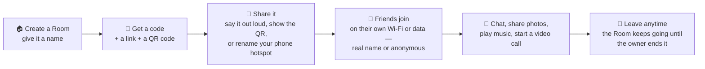
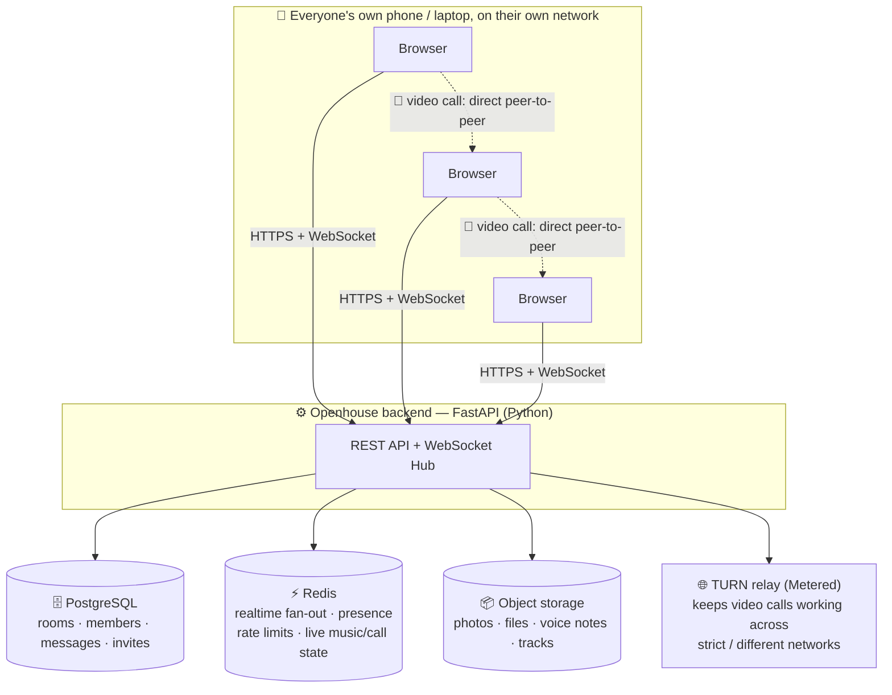
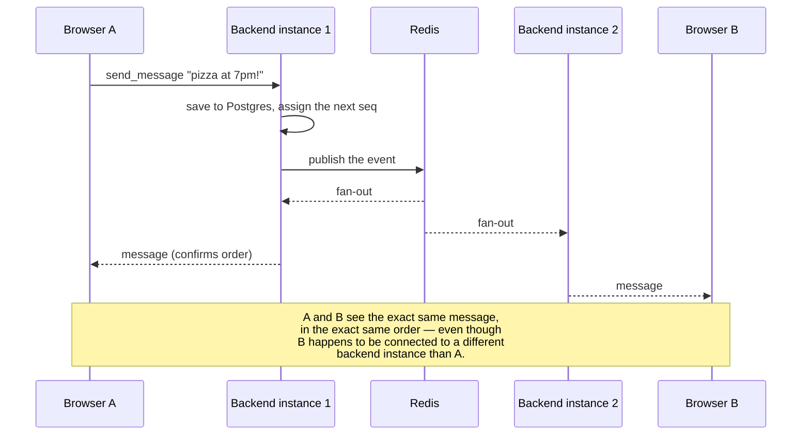
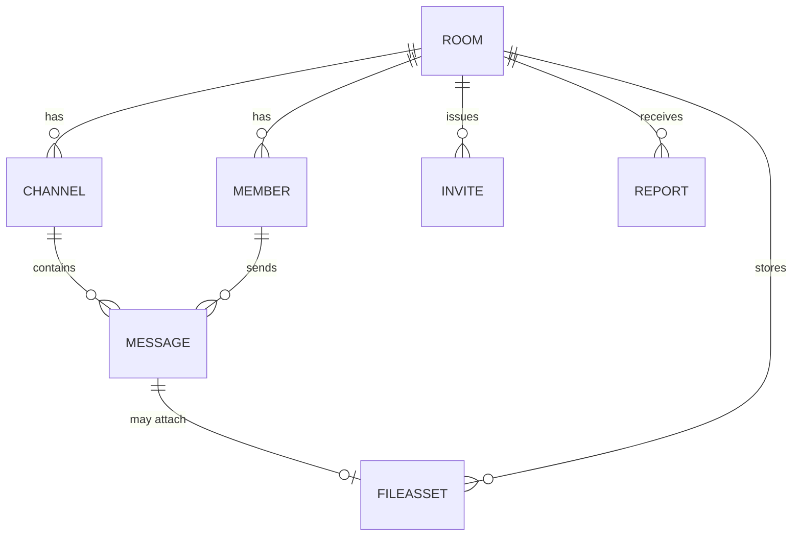
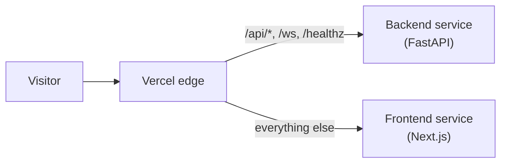

# 🏠 Openhouse

### Chat with the people around you. No phone number, no account, just a code.

Openhouse turns any gathering — a hackathon, a conference, a classroom, a café, a camp — into its own private group chat. Someone creates a **Room**, gets a short code like `4F7K2`, and shares it. Anyone nearby (or anywhere — it works over mobile data too) types the code, picks a name or stays anonymous, and they're in: chatting, sharing photos, playing music together, hopping on a video call. No app store, no sign-up form, no account to lose.

> 🔑 **The core idea:** a Room is a *temporary, disposable chat room tied to a moment*, not a permanent social network. It lives as long as it's useful, and anyone can hand off the keys before they leave.

Founder: **William Mahunda**

---

## 🧭 What actually happens when you use it

No logins, no setup — just: make a room, hand out the code, everyone piles in.



The clever bit: a host's Wi-Fi hotspot can be **renamed** to `Openhouse 4F7K2`. People nearby see that name in their Wi-Fi list and now know the code — but **nobody actually connects to the hotspot**. It's a signpost, not a network. Everyone still uses their own internet.

---

## ✨ Everything you can do in a Room

| | Feature | What it means for you |
|:---:|---|---|
| 💬 | **Channels & chat** | Real-time messages, up to 10 channels per Room, full history, pinned announcements |
| 📎 | **Files & images** | Drop in photos, PDFs, docs — previews appear instantly |
| 🖼️ | **Photo Wall** | Every photo shared in the Room automatically joins a live, shared gallery |
| 🎙️ | **Voice messages** | Record and send a quick voice note, right from the browser |
| 🎵 | **Room DJ** | An owner/mod picks a track and everyone in the Room hears it together, in sync |
| 📹 | **Video calls** | Invite specific people into a call — peer-to-peer video, works across different networks |
| 🛡️ | **Safety tools** | Report, block, kick, ban — enforced on the server, not just hidden in the UI |
| 👑 | **Ownership & recovery** | Hand the Room off to someone else before you leave; a recovery code gets admin back if you lose your device |
| 🙈 | **No accounts, ever** | Join with a name or stay anonymous (`Guest-1234`) — no phone number, no email, no password |

---

## ⚙️ Under the hood

Openhouse is two apps talking to each other: a **Next.js** frontend (what you see in the browser) and a **FastAPI** backend (the brain — rooms, messages, permissions, realtime). They're deployed together as one Vercel project, but live as two files-on-disk projects.



- **Every device only makes outgoing connections** (HTTPS + secure WebSocket), so Openhouse works on locked-down school, café and hotel Wi-Fi without any special setup.
- **The backend can run as several instances at once.** Every event (a new message, someone joining, music starting) is published to Redis, and *every* instance — including the one that published it — is subscribed, so it naturally reaches every connected client no matter which instance they're on. See the message journey below.
- **Video calls don't go through the backend at all.** The backend only exchanges a short "handshake" (who wants to call whom, connection details) over the WebSocket; the actual video/audio streams flow directly between browsers. If two people are on networks that can't reach each other directly (common with phone carriers and strict office/campus Wi-Fi), a **TURN relay** steps in just to forward that media — Openhouse falls back to this automatically, and falls back further to a plain STUN-only connection if no TURN service is configured.

### A message's journey (why multi-server delivery just works)



### The shape of the data



Session tokens, device IDs and recovery codes are only ever stored **hashed** — never the raw value.

### How a visit is routed on Vercel

Frontend and backend deploy as two separate "services" inside one Vercel project, split by URL path:



---

## 🗂️ Project structure

```
openhouse/
├── README.md                 # you are here
├── SPEC.md                   # the original product spec + engineering decision log
├── DEPLOY.md                 # deployment instructions (Vercel)
├── docker-compose.yml        # Postgres + Redis + MinIO, for local dev
├── vercel.json                # routes /api, /ws, /healthz to the backend service
│
├── backend/                  # FastAPI app
│   ├── app/
│   │   ├── main.py            # REST routes, the /ws endpoint, admin API
│   │   ├── config.py          # settings: limits, S3/Redis/DB/TURN config
│   │   ├── models.py          # SQLAlchemy models — rooms, members, messages…
│   │   ├── realtime.py        # the WebSocket Hub + Redis pub/sub fan-out
│   │   ├── rooms.py           # room lifecycle: codes, settings, owner recovery
│   │   ├── members.py         # join flow, sessions, roles, kicks, bans
│   │   ├── messages.py        # channels, ordered messages, history, pins
│   │   ├── files.py           # S3-compatible storage: uploads, downloads, photo wall
│   │   ├── music_library.py   # the royalty-free track library behind Room DJ
│   │   ├── safety.py          # rate limits, reports
│   │   ├── security.py        # token/device hashing, code generation
│   │   └── metrics.py         # daily usage counters
│   ├── migrations/            # Alembic migrations (targets PostgreSQL in production)
│   └── tests/                 # pytest suite — 75+ tests, run against SQLite + fakeredis + moto
│
└── frontend/                  # Next.js 16 app (App Router, TypeScript, Tailwind v4, Zustand)
    └── src/
        ├── app/
        │   ├── page.tsx        # home: join with a code / create a Room
        │   ├── r/[code]/       # the join screen
        │   ├── room/[id]/      # the chat screen
        │   └── admin/          # platform admin page
        ├── components/room/    # the chat UI — messages, sidebar, calls, music, photo wall…
        └── lib/                # API client, WebSocket client, Zustand store, shared types
```

Each backend module is a plain set of async functions over a database session — `main.py` and `realtime.py` are the only two files that know HTTP or WebSocket even exist. That split is what makes the pytest suite able to test real business logic without spinning up real sockets.

---

## 🧰 Tech stack

| Layer | Technology |
|---|---|
| Frontend | Next.js 16 (App Router), TypeScript, Zustand, Tailwind CSS v4 |
| Backend | Python 3.12, FastAPI, Uvicorn, SQLAlchemy 2 (async) + Alembic |
| Realtime | FastAPI WebSockets + Redis pub/sub |
| Database | PostgreSQL (Neon in production, SQLite in tests) |
| File storage | S3-compatible — Cloudflare R2 in production, MinIO locally |
| Video calls | WebRTC mesh, with a Metered TURN relay for NAT traversal |
| Hosting | Vercel — frontend and backend as two services in one project |
| Testing | pytest (backend, 75+ tests), Playwright (end-to-end) |

---

## 🚀 Running it locally

```bash
# 1. Start Postgres, Redis and MinIO (local S3)
docker compose up -d

# 2. Backend
cd backend
pip install -r requirements-dev.txt
alembic upgrade head
uvicorn app.main:app --reload --port 8000

# 3. Frontend, in a second terminal
cd frontend
npm install
npm run dev
```

Then open `http://localhost:3000`. Run the backend test suite with:

```bash
cd backend && pytest
```

See [`DEPLOY.md`](DEPLOY.md) for deploying to Vercel, including the environment variables each service needs.

---

## 🛡️ Safety & privacy, by design

- **No accounts, no phone numbers, no fingerprinting libraries** — just a name (or anonymity) and a session token stored in your browser.
- **Every permission is enforced server-side** — who can kick, ban, pin, or delete isn't just hidden in the UI, it's checked on every single action.
- **Tokens and recovery codes are hashed**, never stored in plain text.
- **Reports, blocks, kicks and bans** are all first-class, built in from day one, not bolted on later.
- A Room's messages and files are deleted once the Room ends.

---

## 📍 Status

The full stack — rooms, chat, files, photo wall, Room DJ, invite-based video calls, safety tools, and a platform admin page — is built and running end to end. For the original spec this was built against, and a running log of real engineering decisions and trade-offs made along the way, see [`SPEC.md`](SPEC.md).
